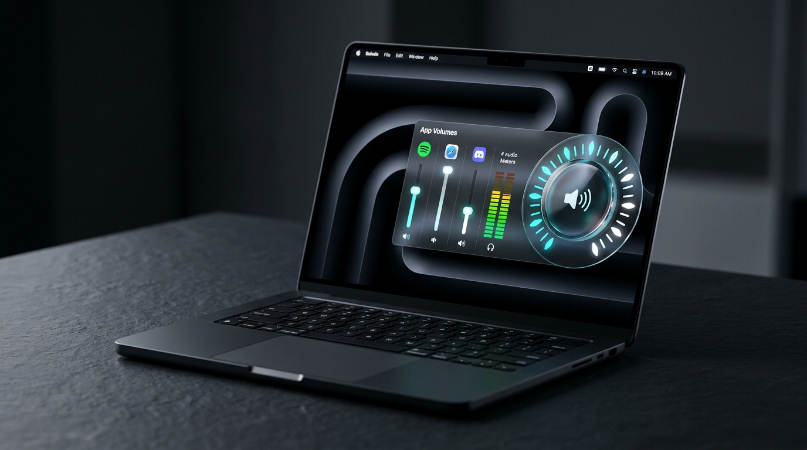
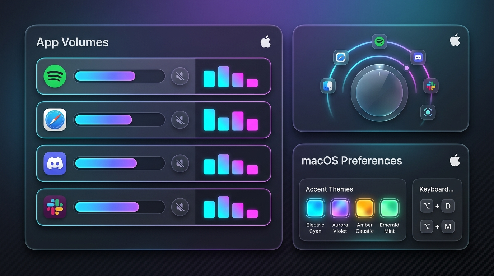
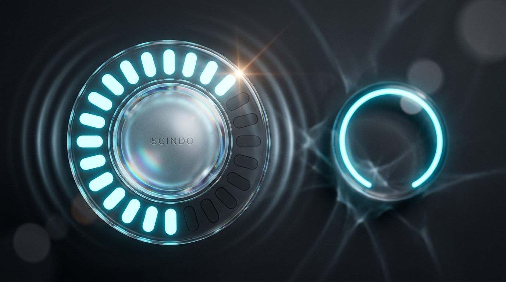
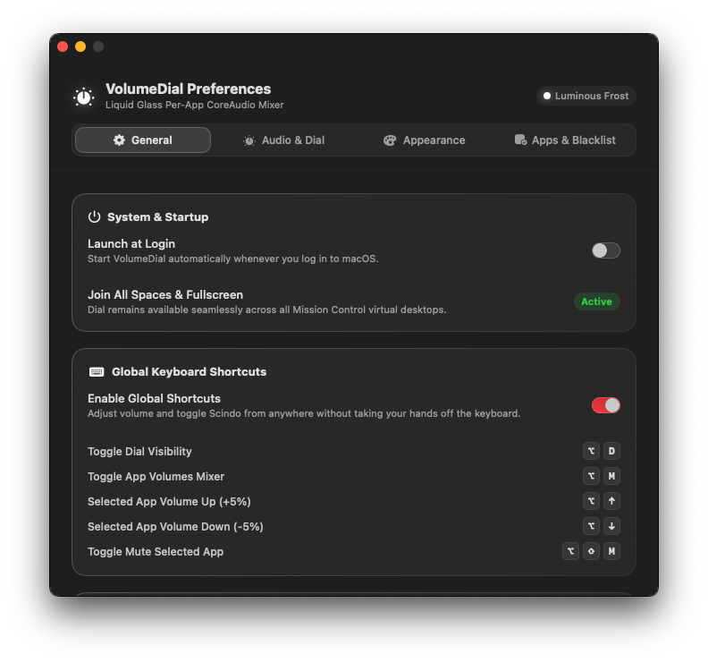

<div align="center">

# Scindo
### Luminous Per-App Audio Mixer for macOS

<p align="center">
  
</p>

[-black?style=flat-square&logo=apple)](https://www.apple.com/macos/sonoma/)
[](https://swift.org)
[](https://developer.apple.com/documentation/coreaudio)
[](https://opensource.org/licenses/MIT)

<p align="center">
  <b>Scindo is an ultra-fluid per-app audio mixer for macOS Sonoma and later. Featuring a luminous Liquid Glass rotary dial, live VU meters, edge-docking physics, and system-wide hotkeys, Scindo leverages native CoreAudio Process Taps to seamlessly isolate and fine-tune app volumes and muting without touching master audio.</b>
</p>

</div>

---

## Real Build Showcase

<div align="center">
  
</div>

<br>

<div align="center">
  
</div>

---

## Key Features

- **Per-App Audio Isolation**: Monitor, adjust, and mute volumes of running macOS applications individually without modifying master system volume.
- **Luminous Liquid Glass Aesthetic**: Multi-layered chromatic refraction, vector caustics, and frosted depth blending organically into dynamic macOS wallpapers.
- **Real-Time Live VU Meters**: 4-bar reactive audio equalizers and acoustic aura glow providing instantaneous RMS and peak volume feedback per process.
- **C¹-Smooth Soft-Knee Saturation**: Built-in DSP limiter preventing harsh digital clipping and distortion when boosting volume up to 150%.
- **Zero-Permission Global Hotkeys**: Carbon hotkeys to summon the dial (`⌥ D`), open the full mixer (`⌥ M`), or toggle mute (`⌥ ⇧ M`) without accessibility permission prompts.
- **Smart Magnetic Edge Docking**: Drag freely or snap to screen edges and corners with auto-tuck resting bubble physics.
- **Curved Radial App Selector**: Long-press or wheel-scroll the dial core to bloom a circular app switcher.
- **Full App Mixer Console**: Expand the dial into a multi-track mixing console with live volume sliders, mute controls, and VU equalizers.

<div align="center">
  
</div>

---

## Requirements

- **macOS 14.2 (Sonoma)** or newer (required for CoreAudio `AudioHardwareCreateProcessTap`)
- **Xcode 15.2+** with Command Line Tools
- **[XcodeGen](https://github.com/yonaskolb/XcodeGen)** (`brew install xcodegen`)

---

## Quick Start

### Automated Build & Run
Run the included build script to generate the Xcode project, compile, apply entitlements, and launch:

```bash
./build_and_run.sh
```

### Manual Build Steps
1. **Generate the Xcode Project**:
   ```bash
   xcodegen generate
   ```

2. **Build the Application**:
   ```bash
   DEVELOPER_DIR="/Applications/Xcode.app/Contents/Developer" \
   xcodebuild -project VolumeDialApp.xcodeproj \
              -scheme VolumeDialApp \
              -configuration Debug \
              -derivedDataPath ./build \
              build
   ```

3. **Sign with CoreAudio Entitlements**:
   ```bash
   codesign --force --deep --sign - \
            --entitlements Config/VolumeDialApp.entitlements \
            ./build/Build/Products/Debug/VolumeDialApp.app
   ```

4. **Launch**:
   ```bash
   open ./build/Build/Products/Debug/VolumeDialApp.app
   ```

---

## Controls & Shortcuts

| Action | Shortcut / Gesture | Description |
| :--- | :--- | :--- |
| **Adjust Volume** | Wheel Scroll / Ring Drag | Adjust volume for the selected app (up to 150% with soft limiter) |
| **Cycle Apps** | Tap Center Disc | Step through running audio apps |
| **Curved App Selector** | Long Press Center Disc | Bloom radial selector to immediately switch active app |
| **Move / Dock Dial** | Drag Disc | Move dial or snap magnetically to screen edges/corners |
| **Toggle Dial** | `⌥ D` / Menu Bar | Hide or unhide the floating dial anywhere on macOS |
| **Toggle Mixer Console** | `⌥ M` / Menu Bar | Expand multi-track volume mixing console |
| **Toggle App Mute** | `⌥ ⇧ M` / Context Menu | Toggle mute on currently selected app |
| **Volume Up (+5%)** | `⌥ ↑` | Increment active application volume |
| **Volume Down (-5%)**| `⌥ ↓` | Decrement active application volume |
| **Preferences Palette**| Menu Bar → Settings (`⌘ ,`) | Configure themes, global hotkeys, and appearance |

---

## Architecture

```
MacVolumeDialSwift/
├── Config/
│   ├── Info.plist                        # macOS app configuration & bundle metadata
│   └── VolumeDialApp.entitlements        # CoreAudio process tap entitlements
├── Sources/
│   ├── App/
│   │   ├── AppDelegate.swift             # App lifecycle, menu bar extra, panel mounting
│   │   ├── GlobalHotKeyManager.swift     # Carbon system-wide hotkey bindings
│   │   └── SnapshotGenerator.swift       # Native screenshot & showcase renderer
│   ├── CoreAudioEngine/
│   │   ├── AudioVolumeController.swift   # Process Tap engine, DSP limiter, live VU RMS
│   │   ├── AudioPersistenceManager.swift # Auto-pruning volume state persistence
│   │   ├── RunningAppsMonitor.swift      # Async app discovery & icon cache
│   │   └── AppSettings.swift             # App preferences and settings store
│   └── Windowing/
│       └── FloatingDialPanel.swift       # Always-on-top, non-activating floating NSPanel
├── Frontend/
│   ├── DialView.swift                    # Rotary dial, petal animations, live VU aura
│   ├── RootView.swift                    # Dial & mixer card coordinator, Live VU bars
│   ├── DockController.swift              # Snapping physics, screen geometry, bubble mode
│   ├── Models.swift                      # Observable model bridging CoreAudio to SwiftUI
│   ├── SettingsView.swift                # Settings & keyboard shortcuts palette
│   ├── SettingsWindowController.swift    # Preferences window lifecycle
│   └── Glass.swift                       # Liquid glass shader and depth modifiers
├── assets/
│   ├── scindo-hero.png                   # Hero banner: Dial & Multi-Track App Mixer
│   ├── scindo-features-bento.png         # Feature suite: Mixer, Radial Menu & Live Equalizer
│   ├── scindo-dial-detail.png            # Macro detail: Active app aura & volume readout
│   ├── scindo-settings.png               # Native Preferences palette & hotkey controls
│   └── scindo-radial-menu.png            # Curved radial application selector
├── project.yml                           # XcodeGen project specification
└── build_and_run.sh                      # One-click build, sign, and launch script
```

---

## License

MIT License. See [LICENSE](LICENSE) for details.
